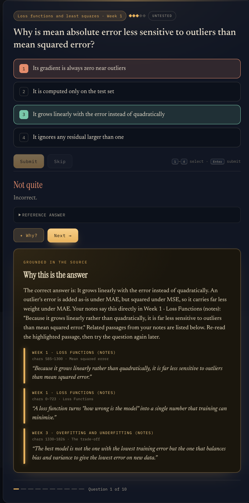

# StudyBuddy

[](https://github.com/Ramy3077/studybuddy/actions/workflows/ci.yml)

Exam revision that quotes your own notes back at you. StudyBuddy ingests slides, notes and lecture
transcripts, turns them into grounded quiz questions, and when you get one wrong it shows the exact
passage that answers it.

> The hosted demo runs on offline providers (keyword retrieval and a scripted explainer, no paid API calls). The real app uses OpenAI embeddings and Claude.

**Live demo:** <https://studybuddy-production-1808.up.railway.app>
Click **Try the demo** for a throwaway guest account, or log in with `demo@example.com` / `revise-demo`.



The hosted demo runs on a small set of original ML notes written for it (linear regression, loss
functions, gradient descent, overfitting, regularisation, k-means). They live in
[`demo/corpus`](demo/corpus). It uses the offline mock providers, so it makes no paid API calls.

## What it does

- **Ingests** PDFs (per page), Markdown notes (Obsidian syntax cleaned up) and caption transcripts,
  chunks them and stores embeddings in Postgres with pgvector.
- **Extracts concepts** per week and **generates questions** (multiple choice and free text) from them.
- **Quizzes** you with spaced repetition: untested and weak concepts first, confidence decays over
  time (about a 14-day half-life).
- **Explains wrong answers** by quoting the source passage, with the week and source title.
- **Leaderboard** computed on the server from graded attempts (guest accounts are excluded).

## How grounding works

Every question stores an `evidence_quote`: 5 to 30 words that must appear word for word in one of the
ingested chunks. `validateQuestion()` (generated questions) and the authored-bank importer both check
this and drop any question whose quote is not found. A question with no supporting text never reaches
the quiz.

When you answer wrong, the "why" panel is built on the server from real chunks, not from model output:

1. the chunk that contains the question's evidence quote, with that quote;
2. up to two more chunks from a pgvector cosine search on the question and answer (in the offline
   demo: BM25 keyword scoring, with a relevance threshold so weak matches are dropped).

The explanation text is written from those passages. The citations, quotes and locations come from
the database, so they can always be checked against the source.

## Architecture

```
notes / slides / transcripts
        │  ingest: clean, chunk, embed
        ▼
  source_chunks (pgvector) ──▶ concepts ──▶ questions (evidence quote checked)
                                                 │
Browser (static SPA) ──HTTP + JWT──▶ Hono API ──▶ quiz: select, grade, update knowledge
                                        │               └─ why: evidence chunk + vector search
                                        └─ leaderboard (aggregate SQL function)
```

- **Backend:** Node 20, TypeScript, [Hono](https://hono.dev), run with `tsx`.
- **Database:** Postgres 16+ with pgvector (HNSW cosine index). Plain SQL migrations.
- **Providers:** OpenAI embeddings and Anthropic Claude behind small interfaces, each with a
  deterministic mock so everything runs without keys. The offline retrieval used by the demo is BM25 keyword
  scoring over chunks with a relevance floor, so weak matches are not shown.
- **Frontend:** one static page in `web/`, no build step.

## Security

These are enforced in code and covered by the tests in `test/`:

- **Two database roles.** Migrations, ingestion and grading use the owner role. Every user request runs
  as `studybuddy_app`, which has Row Level Security forced on user tables. `withUser()` sets
  `app.current_user_id` per transaction with a bound parameter, and policies only return that user's
  rows (`test/rls.test.ts`).
- **Scores cannot be written by clients.** The app role has no insert or update grant on `attempts`.
  The server grades and writes the attempt. The leaderboard counts distinct questions, so replaying a
  correct answer does not raise your score (`test/leaderboard.test.ts`).
- **The answer key is hidden.** The app role cannot select `correct_answer` or `evidence_quote`.
  The "why" endpoints only respond after you have answered that question wrong (`test/why_access.test.ts`).
- **Free-text grading resists prompt injection.** The answer is passed as fenced data, and a coverage
  check overrides a "correct" verdict for answers that miss the reference (`test/grading.test.ts`).
- **Rate limits.** Login and signup are limited per IP and per email. Answer and "why" requests are
  limited per user. Guest accounts are limited per IP and per hour. Answer bodies are size capped.
- **Auth.** scrypt password hashes and HS256 JWTs. The app refuses to start with a missing, default or
  (in production) short `JWT_SECRET`.

## Design decisions and trade-offs

- **Row Level Security with a separate app role, not only `WHERE user_id = ?` in queries.** Filtering in
  application code was the simpler option, but one missed filter leaks another user's data. With RLS the
  database refuses the rows. Cost: two roles and two connection pools, every user request runs in a
  transaction that sets `app.current_user_id`, and privileged work (grading, ingest) has to go through
  the owner pool on purpose.
- **Generated questions must quote the notes word for word.** The alternative was to accept whatever the
  model writes, or check similarity to the notes. An exact substring check (ignoring case and
  whitespace) is easy to reason about and gives the "why" panel a real passage to show. Cost: good
  questions that paraphrase the notes are dropped, so a module ends up with fewer questions.
- **BM25 keyword search for the offline demo instead of embeddings.** The public demo makes no paid API
  calls, so it has no real embeddings. Its hashed word vectors treat common and rare words alike and give
  no natural cut-off, so the demo scores chunks with BM25, which weights rare words and drops weak
  matches below a score floor. With an OpenAI key the app uses pgvector cosine search. Cost: BM25 misses synonyms and
  paraphrases, and it loads every chunk in the module per request, which only works for a small corpus.
- **A fresh guest account per visitor instead of one shared demo login.** Visitors do not see each
  other's progress or share rate-limit buckets. Guest creation is limited per IP and globally per hour,
  and guests older than 3 days are deleted. Cost: a database row per visitor, and the cleanup runs
  when the server boots, so guests pile up between deploys.
- **The server writes scores, clients never do.** The app role has no insert grant on `attempts`, so the
  answer endpoint grades and records in one place. Cost: every answer is a server round trip, and
  free-text answers need a model call to grade.

## Known limitations

- Rate limits are held in memory, so they are per instance and reset on restart. Several instances would
  need a shared store such as Redis.
- Expired guest accounts are only removed when the server boots.
- The offline demo's explanation is a fixed template filled with the cited passages, not written by a
  model.
- BM25 retrieval scans the whole module per request.
- JWTs cannot be revoked before they expire.
- One module per deployment by default (`MODULE_SLUG`).

## Run it locally

Needs Docker and Node 20+.

```bash
cp .env.example .env
printf '\nJWT_SECRET=%s\n' "$(openssl rand -hex 32)" >> .env
docker compose up -d --wait db      # Postgres + pgvector on :5433
npm install

npm run seed                        # shows what will be ingested from VAULT_PATH
npm run seed -- --confirm           # migrate, ingest, build concepts and questions
npm run start                       # http://localhost:8080
```

By default `VAULT_PATH` points at the demo corpus. Point it at your own folder of `Week N/` notes to
revise your own material. With no API keys the seed imports `demo/questions.json`. Set
`OPENAI_API_KEY` and `ANTHROPIC_API_KEY` in `.env` to use real embeddings and have Claude generate
concepts and questions instead.

`npm run start:prod` does what the Docker image does: create the pgvector extension and app role,
apply migrations, seed the demo idempotently, then serve.

### Tests

```bash
npm test        # 61 tests across 9 files; needs the database from docker compose
```

CI runs typecheck, migrations and the full suite against a pgvector service container.

`test/flow.test.ts` is the end-to-end check over HTTP: it ingests a real demo note into a throwaway
module, then a guest logs in, fetches a question, answers it wrong, and asks why. It passes only if the
explanation contains the question's evidence quote and that quote appears word for word in the note on
disk. Tests always use the offline providers, even when API keys are set.

## Deploying

The `Dockerfile` runs `npm run start:prod`, so a fresh Postgres with pgvector is all it needs. On
Railway the demo uses:

| Variable | Value |
|---|---|
| `DATABASE_URL` | owner connection, e.g. `${{pgvector.DATABASE_URL_PRIVATE}}` |
| `APP_DATABASE_URL` | same host, user `studybuddy_app`, a password you choose (the role is created with it) |
| `JWT_SECRET` | `openssl rand -hex 32` |
| `NOTES_CHUNK_WORDS` | `120` for short notes |
| `DEMO_EMAIL`, `DEMO_PASSWORD`, `DEMO_GUESTS=1` | optional demo account and guest button |

## Project layout

```
db/            bootstrap SQL (docker compose) and migrations (schema, RLS, leaderboard)
demo/          original demo corpus and its grounded question bank
src/config.ts  env-driven config
src/db/        pools, withUser (RLS), bootstrap, migrate
src/auth/      scrypt, JWT, bearer middleware
src/providers/ embeddings and LLM, real and mock
src/ingest/    discover, PDF, Markdown, transcript, chunk
src/pipelines/ concepts, questions, authored-bank import
src/quiz/      select, grade, knowledge decay, why
src/server/    Hono app, rate limiting
src/demo/      idempotent demo seed
src/cli/       migrate, ingest, seed, boot
web/           static SPA
test/          end-to-end flow, RLS, leaderboard integrity, grading, answer-key gating, units
```
